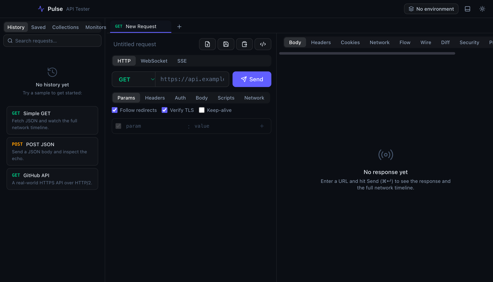

<div align="center">

# ⚡ Pulse

**A fast, native API tester that shows you the whole network path — not just the response.**

[](https://github.com/prabhakarselvan/pulse-api-tester/releases/latest)
[](LICENSE)




</div>

## Why Pulse?

Most API clients show you the response and call it a day. Pulse is built around a
**custom, instrumented HTTP stack in Rust** that measures and exposes every phase of
a request — so you can see *why* something is slow or broken, not just *that* it is.

- **Per‑phase timing** — DNS → TCP → TLS → time‑to‑first‑byte → download, as a waterfall.
- **DNS detail** — which resolver answered, every resolved address, TTL, lookup time.
- **TLS introspection** — negotiated version & cipher, ALPN, and the full certificate chain (subject, issuer, validity, SAN, fingerprint).
- **The bytes on the wire** — the raw request/response, the **encrypted ciphertext** under the negotiated cipher, and the decrypted **HTTP/2 frames**.
- **Every hop** — the full redirect chain with per‑hop status and timing.

It's fast (Rust + a native webview, not Electron), small (~9 MB), and works offline.

## Features

| | |
|---|---|
| **Protocols** | HTTP/1.1 & HTTP/2, WebSocket, Server‑Sent Events, SOAP 1.1/1.2 |
| **Introspection** | Timing waterfall, DNS, TLS/cert chain, HTTP/2 frame inspector, raw + encrypted wire view, redirect hops |
| **Requests** | All methods, query/headers, JSON · text · form · multipart (incl. file) · binary · GraphQL · SOAP bodies |
| **Auth** | Bearer, Basic, API key (header or query), mutual TLS (client certs), HTTP proxy |
| **Scripting** | Pre‑request & post‑response scripts (Postman‑style `pm` API, chai‑like `expect`, `CryptoJS`), run in a sandboxed worker |
| **Workflow** | Collections, environments & `{{variables}}`, dynamic vars (`{{$randomUUID}}`…), a collection runner with value chaining |
| **Import** | Postman v2 collections, OpenAPI 3 / Swagger 2 (JSON or YAML), WSDL, cURL commands |
| **Analysis** | A/B response diff, a TLS/security report card, an endpoint uptime + cert‑expiry monitor, a latency load‑tester |
| **Export** | Generate cURL, `fetch`, or Python from any request |
| **Nice‑to‑haves** | Tabs, keep‑alive connection reuse, light/dark themes, a JSON tree/table viewer |

## Download

Grab the installer for your platform from the **[latest release](https://github.com/prabhakarselvan/pulse-api-tester/releases/latest)**:

| Platform | File |
|---|---|
| **macOS** (Apple Silicon / Intel) | `.dmg` |
| **Windows** | `.msi` or `-setup.exe` |
| **Linux** | `.AppImage`, `.deb`, or `.rpm` |

> **First‑launch note:** these builds are not yet code‑signed, so your OS will warn you the first time.
> - **macOS:** right‑click the app → **Open** (or run `xattr -cr /Applications/Pulse.app`).
> - **Windows:** on the SmartScreen prompt, click **More info → Run anyway**.
> - **Linux (AppImage):** `chmod +x Pulse_*.AppImage` then run it.

## Build from source

Requires [Node.js 18+](https://nodejs.org) and [Rust (stable)](https://rustup.rs). Then:

```bash
npm install
npm run tauri dev     # run with hot reload
npm run tauri build   # produce a release bundle for your OS
```

See [BUILD.md](BUILD.md) for per‑platform prerequisites (MSVC on Windows, WebKitGTK on Linux) and CI details.

## Tech stack

**Frontend** React 19 · TypeScript · Tailwind CSS v4 · Vite · Zustand · CodeMirror
**Backend** Rust · Tauri 2 · hyper · rustls (ring) · hickory‑resolver · tokio · rusqlite

## Security

Pulse runs user‑authored scripts and stores request data locally. Please read
**[SECURITY.md](SECURITY.md)** for the security model, known limitations, and how to
report a vulnerability.

## License

[MIT](LICENSE) © 2026 Prabhakar Selvan
